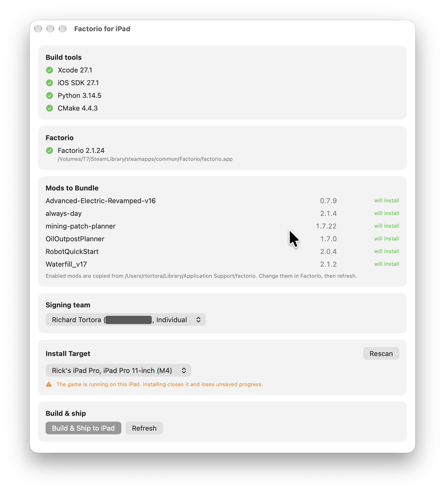

# Factorio on iPad

This repository builds a development-signed iPad app from **your own macOS
installation of Factorio: Space Age**, including bundling any mods you have
enabled.

Supported:

- Magic Keyboard key & mouse control
- Touch controls are supported but...not recommended.
- Saving & loading (local only at the moment)

**Only Factorio: Space Age 2.1.24 is supported.** Older and newer versions do
not work, and the base game probably won't work. If you have a different version
or only want the base game, I would recommend forking this repo and asking AI to
follow the [PORTING_PLAYBOOK.md](./docs/PORTING_PLAYBOOK.md) and updating to
your preferred version.

**NOTE:** You will see a runtime error everytime you launch the app about being
unable to contact Steam; this is normal and expected, as we aren't simulating
Steam on the device. Just dismiss it.

The repository includes porting code, touch controls, Xcode projects, and build
tools. **Factorio itself, game assets, mods, prebuilt apps, certificates, and
saved games are not included.** This is not an official client from Wube
Software.

**Do not share the app you build.** The build artifact that results from running
this project contains Factorio's code and assets (and any mods you enabled), and
the iPad app is a modified version of the game.
[Wube's terms](https://www.factorio.com/terms-of-service) don't allow
distributing altered versions of Factorio. Don't upload the `.app` or `.ipa`,
don't post it anywhere, and don't AirDrop it to anyone. Each person should build
their own from their own copy of the game from a copy that they legally own.

This repo is built upon the very excellent work by
[github-e51](https://github.com/github-e51/factorio-native-arm-ipad). I fixed a
number of problems and customized it to my personal tastes to the point that I
decided to un-fork it and make this version available.

## When Steam updates Factorio

The build only accepts the exact 2.1.24 executable. It checks the executable's
SHA-256 hash, and the patches are specific to that build. When Steam updates
Factorio, the hash changes, the build window reports the version as unsupported,
and you can't build.

- **Already installed the app?** It's unaffected. A Steam update changes the
  copy on your Mac, not the one on your iPad. Only the next build is affected.
- **Need 2.1.24 back?** In Steam, right-click Factorio and choose **Properties →
  Game Versions & Betas**, and pick a branch that provides 2.1.24 if one is
  listed. If you download a version from your account at factorio.com, it will
  have a different hash, so you'll need to use AI to hack this repo to support
  that (or, if you want to YOLO it, just try updating the hash check I guess).
- **Want a newer version?** Support has to be ported. Each update has to be
  re-verified and re-patched; see
  [PORTING_PLAYBOOK.md](./docs/PORTING_PLAYBOOK.md), which uses the 2.1.24
  update as its worked example.

Everything is copied from your own Mac at build time, including every
third-party mod you have enabled in Factorio there. Disable any you don't want
on the iPad before you install.

## 1. Set up the iPad and signing

You only need to do this once.

1. Install Xcode and open it once to complete its setup.
2. Connect the iPad to the Mac over USB, unlock it, and accept the trust prompt.
   Xcode must recognize the device and finish preparing it.
3. On the iPad, enable Developer Mode under **Settings → Privacy & Security →
   Developer Mode** and confirm the requested restart. If the option is missing,
   pair the device with Xcode first.
4. Sign in with your own Apple Account under **Xcode → Settings → Apple
   Accounts**.

**NOTE:** This has not been tested with a free Apple account. The app requests
the `increased-memory-limit` entitlement, which may not be available to one, so
the install might fail or the game might run out of memory. Please report what
happens if you try it.

Apple documents these steps in
[Enabling Developer Mode](https://developer.apple.com/documentation/xcode/enabling-developer-mode-on-a-device)
and
[Running apps on devices](https://developer.apple.com/documentation/xcode/running-your-app-on-simulated-or-physical-devices).

## 2. Build and install

Use a Mac with Apple Silicon. Double-click `Build.command` in Finder, or run it
in a Terminal:

```sh
./Build.command
```

The first run compiles the build window, which takes a few seconds and needs
only the Swift that comes with Xcode. Then it opens:



It shows:

- **Build tools:** a checkmark for each of Xcode, the iOS SDK, Python 3.12+ and
  CMake 3.24+. Anything missing says what to run to fix it. The window checks
  again when you click **Refresh**.
- **Factorio:** the version and location it found, and whether that version is
  supported.
- **Mods to Bundle:** the mods that will be copied. To change them, enable or
  disable mods in Factorio on your Mac, then click **Refresh**.
- **Signing team:** pick the Apple Account team to sign with.
- **Install Target:** pick the connected iPad. If the game is running on it, the
  window asks before installing, because that closes the game and loses unsaved
  progress.

When every check passes and a team and an iPad are chosen, click **Build & Ship
to iPad**. A progress bar and log show the build. The first build takes several
minutes. The window runs setup first if you haven't done it, and it launches the
game on the iPad when it finishes. **Cancel** stops a build in progress.
